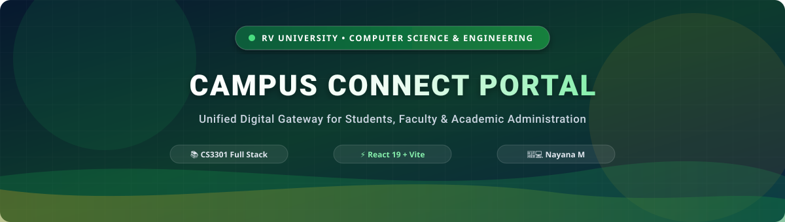

<div align="center">



<br />


<br /><br />

[](https://campus-connect-portal-1-6rcz.onrender.com)
[](https://campus-connect-portal-pxx4.onrender.com)
[](https://www.mongodb.com/atlas)
[](https://github.com/Nayana84-m/campus-connect-portal)

<br /><br />

<a href="#-overview">Overview</a> •
<a href="#-features">Features</a> •
<a href="#-architecture">Architecture</a> •
<a href="#-api-routes">API</a> •
<a href="#-run-locally">Run locally</a> •
<a href="#-deployment">Deployment</a>

</div>

---

## 🌐 Overview

Campus Connect Portal is a responsive university management platform for students, faculty, and administrators. It combines a polished React interface with an Express REST API and MongoDB Atlas persistence so assignment records can be created, displayed, updated, deleted, and retained after a page refresh.

This project was developed for **CS3301 Full Stack Development** at **RV University**.

## ✨ Features

- 🏛️ RV University inspired landing page with responsive navigation
- 🎞️ Interactive campus highlights carousel
- 👨‍🎓 Student, 👨‍🏫 Faculty, and 🛡️ Admin portal views
- 🔐 Login and registration interface with role selection
- 📝 Assignment creation from the Student Portal
- 📖 Assignment retrieval from MongoDB Atlas
- 🔁 Assignment status updates through HTTP PUT
- 🗑️ Assignment deletion through HTTP DELETE
- ✅ Mongoose validation for required assignment fields
- 🌍 CORS-enabled Express API for frontend integration
- 🚀 Separate Render deployments for frontend and backend

> The login and role screens are currently client-side interface demonstrations. The assignment workflow is the live MongoDB-backed feature.

## 🧩 Architecture

```text
React + Vite frontend
        │
        │  HTTP / JSON
        ▼
Express REST API on Render
        │
        │  Mongoose
        ▼
MongoDB Atlas
```

## 📁 Project structure

```text
campus-connect-portal/
├── assets/
│   ├── banner.svg
│   └── footer.svg
├── client/
│   ├── index.html
│   ├── .env.example
│   └── src/
│       ├── App.jsx
│       ├── main.jsx
│       ├── carousel.js
│       ├── portal-navigation.js
│       └── components/
│           ├── AuthModule.jsx
│           ├── StudentPortal.jsx
│           ├── FacultyPortal.jsx
│           └── AdminPortal.jsx
├── server/
│   ├── .env.example
│   └── src/
│       ├── app.js
│       ├── config/db.js
│       └── models/Assignment.js
├── package.json
└── README.md
```

## 🛠️ Technology stack

| Layer | Technology |
| --- | --- |
| Frontend | React 19, Vite, JavaScript, CSS |
| Backend | Node.js, Express 5 |
| Database | MongoDB Atlas, Mongoose |
| API communication | Fetch, JSON, CORS |
| Hosting | Render |
| Version control | Git and GitHub |

## 🔌 API routes

| Method | Route | Purpose |
| --- | --- | --- |
| `GET` | `/` | Backend status response |
| `GET` | `/api/assignments` | Return all assignments |
| `GET` | `/api/assignments/:id` | Return one assignment |
| `POST` | `/api/assignments` | Create an assignment |
| `PUT` | `/api/assignments/:id` | Update assignment details or status |
| `PUT` | `/api/assignments/:id/submit` | Mark an assignment as submitted |
| `DELETE` | `/api/assignments/:id` | Delete an assignment |

## 💻 Run locally

### Prerequisites

- Node.js 18 or newer
- npm
- MongoDB Atlas account and database user

### 1. Clone the repository

```bash
git clone https://github.com/Nayana84-m/campus-connect-portal.git
cd campus-connect-portal
```

### 2. Configure the backend

Create `server/.env` using `server/.env.example`:

```env
MONGO_URI=your_mongodb_atlas_connection_string
```

Install and start the backend:

```bash
cd server
npm install
npm run dev
```

The API runs at `http://localhost:5000`.

### 3. Configure and start the frontend

Open a second terminal:

```bash
cd client
copy .env.example .env
npm install
npm run dev
```

The frontend runs at `http://localhost:5173`.

The frontend uses this local API setting:

```env
VITE_API_URL=http://localhost:5000
```

## ✅ Verification

```bash
cd client
npm run lint
npm run build
```

The full workflow to verify is:

1. Load assignments from MongoDB Atlas.
2. Create an assignment through the React form.
3. Update its submission status.
4. Refresh and confirm persistence.
5. Delete the assignment.

## 🚀 Deployment

### Backend Render service

| Setting | Value |
| --- | --- |
| Root directory | `server` |
| Build command | `npm install` |
| Start command | `npm start` |
| Environment variable | `MONGO_URI` |

### Frontend Render static site

| Setting | Value |
| --- | --- |
| Root directory | `client` |
| Build command | `npm install && npm run build` |
| Publish directory | `dist` |
| Environment variable | `VITE_API_URL` |

The deployed application is available here:

- [Campus Connect frontend](https://campus-connect-portal-1-6rcz.onrender.com)
- [Campus Connect backend](https://campus-connect-portal-pxx4.onrender.com)

## 🔄 Updating the deployed project

For code changes:

```bash
git add .
git commit -m "describe the change"
git push
```

Render automatically redeploys after the GitHub push. MongoDB does not need to be connected again manually; the backend reconnects using `MONGO_URI` whenever it starts. Only update the Render environment variables if the database connection string changes.

## 👩‍💻 Author

<div align="center">


### Nayana M

RV University • School of Computer Science and Engineering
CS3301 Full Stack Development

[](https://github.com/Nayana84-m)

<br />


<sub>Built with React, Express, MongoDB Atlas, and a lot of campus energy ✨</sub>

</div>
